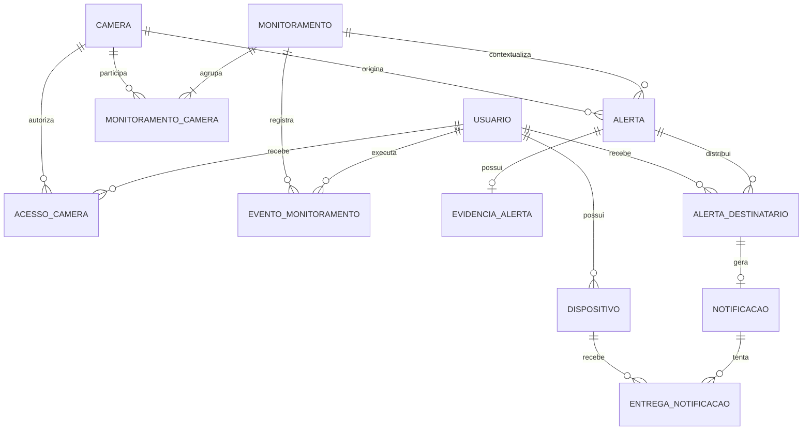
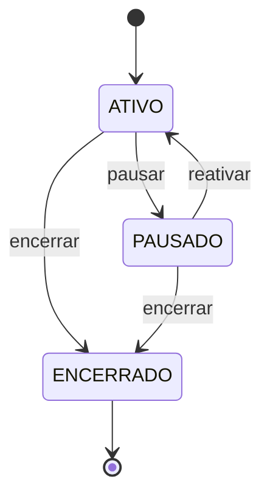

# PoolSafe - Schema Lógico do Banco de Dados

> Especificação canônica do schema MySQL do MVP. Este documento define o modelo; a criação das tabelas e das migrações será feita em uma etapa posterior.

**Versão:** 1.0  
**Status:** aprovado para orientar o `domain-model.md`, o contrato da API e as futuras migrações  
**Última consolidação:** 18 de setembro de 2026  
**SGBD de destino:** MySQL 8.4

## 1. Objetivo

Este documento transforma as decisões de produto e os diagramas acadêmicos do PoolSafe em um schema lógico coerente para o MVP. Ele define:

- entidades, campos e relacionamentos;
- estados persistidos e estados calculados;
- integridade, índices e regras transacionais;
- autorização sobre câmeras, monitoramentos e alertas;
- registro de dispositivos e rastreabilidade de notificações;
- armazenamento e retenção da evidência;
- fronteiras entre o banco, a API Node.js, o N8N e o serviço de visão computacional.

O documento não contém o DDL definitivo. Tipos e constraints abaixo devem ser convertidos em migrações somente depois da escolha do framework, do ORM ou do cliente SQL do backend.

## 2. Decisões consolidadas

1. A associação entre usuários e câmeras é muitos-para-muitos e recebe o nome `ACESSO_CAMERA`.
2. A associação de câmeras é realizada pela administração, fora do aplicativo mobile.
3. Uma sessão de monitoramento utiliza uma ou várias câmeras.
4. Uma câmera não participa simultaneamente de duas sessões de monitoramento não encerradas.
5. Todos os usuários com acesso ativo à câmera no instante da detecção tornam-se destinatários do alerta.
6. Alterar ou revogar um acesso depois da detecção não modifica retroativamente os destinatários daquele alerta.
7. Qualquer usuário autorizado da sessão pode ativá-la ou pausá-la.
8. Para evitar que alguém controle câmeras às quais não tem acesso, o usuário precisa ter acesso ativo a todas as câmeras da sessão. No MVP, as câmeras agrupadas em uma sessão devem compartilhar o mesmo conjunto de usuários autorizados.
9. O alerta é um fato imutável de detecção. Ele não possui estado de “visualizado”, “verificado” ou “resolvido”.
10. A evidência fica separada do alerta para não carregar conteúdo binário nas consultas de lista.
11. Uma instalação do aplicativo é representada por `DISPOSITIVO`; uma conta pode ter vários dispositivos.
12. A entrega de push é rastreada em dois níveis: a notificação destinada ao usuário e a tentativa de entrega em cada dispositivo.
13. Senhas, tokens de sessão e tokens de recuperação nunca são armazenados em texto puro.
14. Streaming, credenciais da câmera, endereço IP e URL técnica não são dados expostos pelo schema da aplicação.

## 3. Convenções físicas

| Assunto | Convenção |
|---|---|
| Tabelas e colunas | `snake_case`, nomes no singular |
| Chaves primárias | `id BIGINT UNSIGNED AUTO_INCREMENT` |
| Chaves estrangeiras | `<entidade>_id` |
| Datas | `DATETIME(3)` em UTC |
| Booleanos | `BOOLEAN NOT NULL`, armazenado pelo MySQL como `TINYINT(1)` |
| Textos | `utf8mb4` com collation Unicode compatível com MySQL 8.4 |
| Estados | `VARCHAR` com `CHECK`, evitando acoplamento ao tipo `ENUM` do MySQL |
| Auditoria básica | `criado_em` e `atualizado_em` quando a linha pode mudar |
| Exclusão de domínio | inativação ou revogação; exclusão física somente pela política de retenção |

E-mail deve ser normalizado em minúsculas antes da persistência. Os nomes lógicos aparecem em maiúsculas neste documento; os nomes físicos permanecem em minúsculas.

## 4. Visão dos relacionamentos

As tabelas de autenticação e `log_sistema` foram omitidas do diagrama para preservar a leitura, mas estão definidas adiante.

## 5. Tabelas de identidade e autenticação

### 5.1 `usuario`

Representa a conta de uma pessoa responsável.

| Coluna | Tipo | Nulo | Regra |
|---|---|---:|---|
| `id` | `BIGINT UNSIGNED` | não | PK, auto incremento |
| `nome` | `VARCHAR(120)` | não | nome exibido no aplicativo |
| `email` | `VARCHAR(254)` | não | normalizado; único |
| `senha_hash` | `VARCHAR(255)` | não | hash produzido por algoritmo próprio para senhas |
| `telefone` | `VARCHAR(20)` | sim | opcional; não participa da autenticação no MVP |
| `status` | `VARCHAR(20)` | não | `ATIVO`, `BLOQUEADO` ou `DESATIVADO` |
| `email_verificado_em` | `DATETIME(3)` | sim | reservado para a jornada de verificação |
| `ultimo_login_em` | `DATETIME(3)` | sim | auditoria de acesso bem-sucedido |
| `criado_em` | `DATETIME(3)` | não | UTC |
| `atualizado_em` | `DATETIME(3)` | não | UTC |
| `desativado_em` | `DATETIME(3)` | sim | preenchido quando `status = DESATIVADO` |

**Constraints e índices:** `UNIQUE(email)`; índice em `status` somente se a administração precisar listar contas por situação.

### 5.2 `sessao_autenticacao`

Mantém a sessão renovável definida pelo contrato da API. O access token é um JWT curto; esta tabela armazena somente o hash do segredo do refresh token opaco e rotativo.

| Coluna | Tipo | Nulo | Regra |
|---|---|---:|---|
| `id` | `BIGINT UNSIGNED` | não | PK |
| `usuario_id` | `BIGINT UNSIGNED` | não | FK para `usuario` |
| `dispositivo_id` | `BIGINT UNSIGNED` | sim | FK para `dispositivo` |
| `token_hash` | `CHAR(64)` | não | hash SHA-256 do segredo do refresh token; único |
| `expira_em` | `DATETIME(3)` | não | validade absoluta da sessão, inicialmente 30 dias |
| `ultimo_uso_em` | `DATETIME(3)` | sim | última rotação bem-sucedida |
| `revogada_em` | `DATETIME(3)` | sim | logout, troca de senha ou revogação |
| `criado_em` | `DATETIME(3)` | não | UTC |

O valor utilizável do refresh token é entregue ao cliente apenas na criação ou rotação. O banco guarda somente o hash. O `sessionId` identificável no formato do token permite localizar a linha; o segredo é comparado com segurança. Reutilização de segredo anterior revoga a sessão.

### 5.3 `token_recuperacao_senha`

Registra solicitações de redefinição de senha sem armazenar o segredo enviado por e-mail.

| Coluna | Tipo | Nulo | Regra |
|---|---|---:|---|
| `id` | `BIGINT UNSIGNED` | não | PK |
| `usuario_id` | `BIGINT UNSIGNED` | não | FK para `usuario` |
| `token_hash` | `CHAR(64)` | não | único |
| `expira_em` | `DATETIME(3)` | não | prazo curto definido pela API |
| `utilizado_em` | `DATETIME(3)` | sim | impede reutilização |
| `criado_em` | `DATETIME(3)` | não | UTC |

## 6. Dispositivos móveis

### 6.1 `dispositivo`

Representa uma instalação do aplicativo associada a uma conta, e não necessariamente um aparelho físico permanente.

| Coluna | Tipo | Nulo | Regra |
|---|---|---:|---|
| `id` | `BIGINT UNSIGNED` | não | PK |
| `usuario_id` | `BIGINT UNSIGNED` | não | FK para `usuario` |
| `identificador_instalacao` | `VARCHAR(128)` | não | UUID gerado pelo app |
| `plataforma` | `VARCHAR(20)` | não | `ANDROID` ou `IOS` |
| `fcm_token` | `VARCHAR(512)` | sim | token atual; único quando presente |
| `ativo` | `BOOLEAN` | não | elegibilidade da instalação |
| `token_atualizado_em` | `DATETIME(3)` | sim | renovação do FCM Token |
| `ultimo_acesso_em` | `DATETIME(3)` | sim | última atividade conhecida |
| `invalidado_em` | `DATETIME(3)` | sim | logout ou falha definitiva do token |
| `criado_em` | `DATETIME(3)` | não | UTC |
| `atualizado_em` | `DATETIME(3)` | não | UTC |

**Constraints e índices:** `UNIQUE(usuario_id, identificador_instalacao)`; `UNIQUE(fcm_token)`; índice `(usuario_id, ativo)`.

Ao receber um FCM Token já ligado a outra instalação, a atualização deve ocorrer em transação, removendo o vínculo anterior antes de associá-lo ao dispositivo atual. Logout inativa a instalação e revoga suas sessões, mas preserva o histórico de entrega.

## 7. Câmeras e autorização

### 7.1 `camera`

Representa a câmera conhecida pelo PoolSafe. Os dados apresentados ao aplicativo são funcionais; detalhes de rede permanecem na infraestrutura de captura.

| Coluna | Tipo | Nulo | Regra |
|---|---|---:|---|
| `id` | `BIGINT UNSIGNED` | não | PK |
| `codigo_integracao` | `VARCHAR(100)` | não | identificador estável usado por Python/N8N; único |
| `nome` | `VARCHAR(100)` | não | nome amigável |
| `localizacao` | `VARCHAR(150)` | sim | exemplo: “Piscina principal” |
| `status_administrativo` | `VARCHAR(20)` | não | `ATIVA` ou `INATIVA` |
| `ultima_comunicacao_em` | `DATETIME(3)` | sim | heartbeat ou frame confirmado pelo backend |
| `criado_em` | `DATETIME(3)` | não | UTC |
| `atualizado_em` | `DATETIME(3)` | não | UTC |
| `desativado_em` | `DATETIME(3)` | sim | preenchido quando inativada |

**Constraints e índices:** `UNIQUE(codigo_integracao)`; índice `(status_administrativo, ultima_comunicacao_em)`.

O estado de conexão não é persistido para evitar que fique obsoleto. A API calcula:

- `DESCONHECIDA`: nunca houve comunicação ou não há informação confiável;
- `ONLINE`: `ultima_comunicacao_em` ocorreu dentro da janela operacional;
- `OFFLINE`: a câmera está administrativamente ativa, mas ultrapassou a janela.

A janela inicial do MVP será de 90 segundos e deverá ser configurável no backend. `INATIVA` é uma condição administrativa separada, não um estado de rede.

### 7.2 `acesso_camera`

Materializa a relação muitos-para-muitos entre `usuario` e `camera`.

| Coluna | Tipo | Nulo | Regra |
|---|---|---:|---|
| `id` | `BIGINT UNSIGNED` | não | PK |
| `usuario_id` | `BIGINT UNSIGNED` | não | FK para `usuario` |
| `camera_id` | `BIGINT UNSIGNED` | não | FK para `camera` |
| `ativo` | `BOOLEAN` | não | autoriza consulta, controle e futuros alertas |
| `concedido_em` | `DATETIME(3)` | não | início do vínculo |
| `revogado_em` | `DATETIME(3)` | sim | obrigatório quando inativado |
| `criado_em` | `DATETIME(3)` | não | UTC |
| `atualizado_em` | `DATETIME(3)` | não | UTC |

**Índices:** `(usuario_id, ativo, camera_id)` e `(camera_id, ativo, usuario_id)`.

No MVP, não há papéis como proprietário e convidado: todo acesso ativo concede as mesmas capacidades previstas para o usuário responsável. A administração é a única origem de concessão ou revogação. O identificador próprio permite preservar diferentes períodos de acesso do mesmo usuário à mesma câmera. Uma transação administrativa deve impedir que dois períodos do mesmo par estejam ativos simultaneamente.

## 8. Sessões de monitoramento

### 8.1 `monitoramento`

Representa uma sessão compartilhada de monitoramento. A sessão guarda o estado operacional solicitado pelo usuário, não a disponibilidade calculada das câmeras.

| Coluna | Tipo | Nulo | Regra |
|---|---|---:|---|
| `id` | `BIGINT UNSIGNED` | não | PK |
| `status` | `VARCHAR(20)` | não | `ATIVO`, `PAUSADO` ou `ENCERRADO` |
| `iniciado_por_usuario_id` | `BIGINT UNSIGNED` | não | FK para `usuario` |
| `iniciado_em` | `DATETIME(3)` | não | início da sessão |
| `pausado_em` | `DATETIME(3)` | sim | última pausa; nulo quando nunca pausada |
| `encerrado_em` | `DATETIME(3)` | sim | obrigatório no estado terminal |
| `criado_em` | `DATETIME(3)` | não | UTC |
| `atualizado_em` | `DATETIME(3)` | não | UTC |

**Índices:** `(status, iniciado_em)` e `iniciado_por_usuario_id`.

Transições válidas:

`ENCERRADO` é terminal. O aplicativo do MVP oferece ativar/reativar e pausar; encerrar é uma operação administrativa ou de substituição da sessão. Os estados `DEGRADADO` e `INDISPONIVEL` exibidos na Home são calculados pela API a partir do status da sessão e da conectividade de suas câmeras.

### 8.2 `monitoramento_camera`

Associa uma ou várias câmeras à sessão.

| Coluna | Tipo | Nulo | Regra |
|---|---|---:|---|
| `monitoramento_id` | `BIGINT UNSIGNED` | não | PK composta; FK para `monitoramento` |
| `camera_id` | `BIGINT UNSIGNED` | não | PK composta; FK para `camera` |
| `adicionada_em` | `DATETIME(3)` | não | UTC |

**Constraints e índices:** PK `(monitoramento_id, camera_id)`; índice `(camera_id, monitoramento_id)`.

Regras que exigem transação na camada de aplicação:

- uma sessão precisa conter ao menos uma câmera antes de ser confirmada;
- cada câmera da sessão precisa possuir ao menos um `acesso_camera` ativo antes da ativação;
- suas câmeras não mudam depois do início; uma composição diferente cria nova sessão;
- uma câmera pode constar em vários monitoramentos históricos, mas em apenas um com estado `ATIVO` ou `PAUSADO`;
- quem ativa ou pausa precisa possuir `acesso_camera.ativo = true` para todas as câmeras da sessão.

A exclusividade entre sessões não encerradas não deve ser simulada por consulta sem bloqueio. A implementação futura precisa usar transação e bloqueio das linhas das câmeras, ou outra constraint técnica equivalente.

### 8.3 `evento_monitoramento`

Audita cada mudança de estado, inclusive qual usuário compartilhou o efeito com os demais.

| Coluna | Tipo | Nulo | Regra |
|---|---|---:|---|
| `id` | `BIGINT UNSIGNED` | não | PK |
| `monitoramento_id` | `BIGINT UNSIGNED` | não | FK |
| `usuario_id` | `BIGINT UNSIGNED` | sim | FK; nulo somente para ação automática/sistema |
| `tipo` | `VARCHAR(20)` | não | `INICIADO`, `PAUSADO`, `REATIVADO` ou `ENCERRADO` |
| `motivo` | `VARCHAR(255)` | sim | contexto administrativo ou automático |
| `ocorrido_em` | `DATETIME(3)` | não | UTC |

**Índice:** `(monitoramento_id, ocorrido_em)`.

## 9. Alertas e evidências

### 9.1 `alerta`

Representa uma possível situação de risco confirmada pelo critério temporal do serviço de visão. Não confirma afogamento e não guarda estado de leitura.

| Coluna | Tipo | Nulo | Regra |
|---|---|---:|---|
| `id` | `BIGINT UNSIGNED` | não | PK |
| `chave_evento` | `VARCHAR(100)` | não | chave idempotente produzida na origem; única |
| `monitoramento_id` | `BIGINT UNSIGNED` | não | FK para a sessão vigente |
| `camera_id` | `BIGINT UNSIGNED` | não | FK para a câmera de origem |
| `tipo` | `VARCHAR(50)` | não | vocabulário controlado; inicial: `POSSIVEL_RISCO` |
| `severidade` | `VARCHAR(20)` | não | `ATENCAO` ou `CRITICA` |
| `detectado_em` | `DATETIME(3)` | não | instante do evento na origem |
| `confianca` | `DECIMAL(5,4)` | sim | de `0.0000` a `1.0000` |
| `versao_modelo` | `VARCHAR(50)` | sim | rastreabilidade da inferência |
| `dados_tecnicos` | `JSON` | sim | metadados não essenciais e versionáveis |
| `criado_em` | `DATETIME(3)` | não | recebimento/persistência no sistema |

**Constraints e índices:** `UNIQUE(chave_evento)`; `CHECK(confianca BETWEEN 0 AND 1)` quando preenchida; índices `(camera_id, detectado_em DESC)` e `(monitoramento_id, detectado_em DESC)`.

`chave_evento` torna o webhook idempotente: uma repetição por timeout ou retry não cria um segundo alerta. `dados_tecnicos` não deve receber segredos, imagem em Base64 nem campos necessários às regras centrais.

### 9.2 `evidencia_alerta`

Armazena no máximo um frame de evidência por alerta no MVP.

| Coluna | Tipo | Nulo | Regra |
|---|---|---:|---|
| `id` | `BIGINT UNSIGNED` | não | PK |
| `alerta_id` | `BIGINT UNSIGNED` | não | FK; único |
| `mime_type` | `VARCHAR(100)` | não | inicialmente `image/jpeg` ou `image/png` |
| `conteudo` | `LONGBLOB` | sim | bytes da imagem, nunca Base64; nulo somente após remoção |
| `tamanho_bytes` | `BIGINT UNSIGNED` | não | validação e observabilidade |
| `hash_sha256` | `CHAR(64)` | não | integridade e deduplicação diagnóstica |
| `criado_em` | `DATETIME(3)` | não | UTC |
| `expira_em` | `DATETIME(3)` | não | inicialmente `criado_em + 30 dias` |
| `removida_em` | `DATETIME(3)` | sim | confirma a limpeza do conteúdo |

**Constraints e índices:** `UNIQUE(alerta_id)`; índice `(expira_em, removida_em)`.

Enquanto `removida_em` for nulo, `conteudo` precisa estar preenchido. A limpeza zera `conteudo` e preenche `removida_em` na mesma transação. O `LONGBLOB` é a decisão do MVP por simplicidade e aderência ao TC2. A API deve transmitir o binário por endpoint autenticado e autorizado; nunca deve produzir URL pública. Uma futura migração para object storage pode manter a mesma entidade e trocar `conteudo` por referência privada sem mudar o conceito de domínio.

### 9.3 `alerta_destinatario`

Congela quem estava autorizado a receber o alerta no instante da detecção.

| Coluna | Tipo | Nulo | Regra |
|---|---|---:|---|
| `alerta_id` | `BIGINT UNSIGNED` | não | PK composta; FK |
| `usuario_id` | `BIGINT UNSIGNED` | não | PK composta; FK |
| `atribuido_em` | `DATETIME(3)` | não | UTC |

**Constraints e índices:** PK `(alerta_id, usuario_id)`; índice `(usuario_id, atribuido_em DESC)` para o Histórico.

Essa tabela é a autorização histórica. O usuário acessa um alerta se constar nela, mesmo que não possua dispositivo com FCM Token. No fluxo normal, todo alerta possui ao menos um destinatário. Se uma inconsistência administrativa deixar a câmera sem acessos ativos, o alerta ainda é preservado sem destinatários e um erro operacional de alta prioridade deve ser registrado. A tabela não possui `visualizado`, `confirmado` ou `resolvido`.

## 10. Notificações push

### 10.1 `notificacao`

Representa a notificação lógica destinada a um usuário, separada das entregas aos seus dispositivos.

| Coluna | Tipo | Nulo | Regra |
|---|---|---:|---|
| `id` | `BIGINT UNSIGNED` | não | PK |
| `alerta_id` | `BIGINT UNSIGNED` | não | FK composta com `usuario_id` para `alerta_destinatario` |
| `usuario_id` | `BIGINT UNSIGNED` | não | destinatário |
| `titulo` | `VARCHAR(120)` | não | snapshot do conteúdo enviado |
| `mensagem` | `VARCHAR(500)` | não | linguagem não conclusiva |
| `status` | `VARCHAR(30)` | não | `PENDENTE`, `PROCESSADA`, `PARCIAL`, `FALHA` ou `SEM_DISPOSITIVO` |
| `criada_em` | `DATETIME(3)` | não | UTC |
| `processada_em` | `DATETIME(3)` | sim | fim do primeiro ciclo de envio |

**Constraints e índices:** `UNIQUE(alerta_id, usuario_id)`; índice `(usuario_id, criada_em DESC)`; índice `(status, criada_em)`.

O status geral é calculado a partir das entregas: `PROCESSADA` quando todas foram aceitas pelo FCM, `PARCIAL` quando apenas parte foi aceita, `FALHA` quando nenhuma foi aceita e `SEM_DISPOSITIVO` quando não havia instalação elegível.

### 10.2 `entrega_notificacao`

Representa o envio da notificação a uma instalação específica.

| Coluna | Tipo | Nulo | Regra |
|---|---|---:|---|
| `id` | `BIGINT UNSIGNED` | não | PK |
| `notificacao_id` | `BIGINT UNSIGNED` | não | FK |
| `dispositivo_id` | `BIGINT UNSIGNED` | não | FK |
| `status` | `VARCHAR(30)` | não | `PENDENTE`, `ENVIADA`, `FALHA` ou `TOKEN_INVALIDO` |
| `tentativas` | `SMALLINT UNSIGNED` | não | começa em zero |
| `fcm_message_id` | `VARCHAR(255)` | sim | identificador retornado pelo FCM |
| `erro_codigo` | `VARCHAR(100)` | sim | código tratável |
| `erro_detalhe` | `VARCHAR(500)` | sim | sem segredos ou payload sensível |
| `ultima_tentativa_em` | `DATETIME(3)` | sim | UTC |
| `enviada_em` | `DATETIME(3)` | sim | aceite do pedido pelo FCM |
| `criada_em` | `DATETIME(3)` | não | UTC |

**Constraints e índices:** `UNIQUE(notificacao_id, dispositivo_id)`; índice `(status, ultima_tentativa_em)` para retries.

`ENVIADA` significa que o FCM aceitou a solicitação, não que o usuário viu a mensagem e nem que o sistema operacional a exibiu. Falha definitiva de token altera a entrega para `TOKEN_INVALIDO` e inativa o token correspondente no dispositivo.

## 11. Logs operacionais

### 11.1 `log_sistema`

Registra eventos relevantes do pipeline e da aplicação sem misturá-los com o domínio do alerta.

| Coluna | Tipo | Nulo | Regra |
|---|---|---:|---|
| `id` | `BIGINT UNSIGNED` | não | PK |
| `nivel` | `VARCHAR(20)` | não | `INFO`, `AVISO` ou `ERRO` |
| `categoria` | `VARCHAR(50)` | não | exemplo: `DETECCAO`, `N8N`, `FCM`, `API` |
| `descricao` | `VARCHAR(500)` | não | mensagem segura para operação |
| `alerta_id` | `BIGINT UNSIGNED` | sim | FK opcional |
| `monitoramento_id` | `BIGINT UNSIGNED` | sim | FK opcional |
| `camera_id` | `BIGINT UNSIGNED` | sim | FK opcional |
| `dados` | `JSON` | sim | contexto técnico estruturado e não sensível |
| `ocorrido_em` | `DATETIME(3)` | não | UTC |

**Índices:** `(ocorrido_em)`; `(categoria, ocorrido_em)`; FKs opcionais conforme os casos de consulta.

Logs não substituem métricas ou logs de infraestrutura. Não devem conter senha, tokens, imagem, URL assinada ou credenciais.

## 12. Fluxo transacional de criação de alerta

O processamento do N8N deve se comportar como uma unidade idempotente:

1. localizar a câmera por `codigo_integracao`;
2. resolver pelo `camera_id` exatamente um monitoramento `ATIVO` que contenha a câmera; o evento de visão não informa o identificador interno da sessão;
3. inserir `alerta` usando `chave_evento`, ou recuperar o existente em caso de retry;
4. salvar a evidência, quando válida e ainda inexistente;
5. copiar para `alerta_destinatario` todos os usuários com `acesso_camera.ativo = true` para a câmera de origem;
6. criar uma `notificacao` por destinatário;
7. copiar os dispositivos ativos com FCM Token para `entrega_notificacao`;
8. concluir a transação antes de chamar o FCM;
9. efetuar os envios e atualizar cada entrega de forma idempotente;
10. consolidar o estado da notificação e registrar falhas operacionais necessárias.

Persistir antes de enviar evita uma notificação sem alerta consultável. Não se deve manter uma transação MySQL aberta durante chamadas de rede ao FCM.

Se a etapa 5 não encontrar destinatários, o alerta permanece registrado para rastreabilidade, nenhuma notificação é criada e o workflow registra a inconsistência com prioridade alta.

## 13. Integridade referencial e exclusão

| Relação | Política recomendada |
|---|---|
| Entidades históricas para `usuario`, `camera` e `monitoramento` | `RESTRICT`; usar inativação |
| `monitoramento_camera` ao remover monitoramento ainda sem histórico | `CASCADE`, somente em operação administrativa controlada |
| `evento_monitoramento` | preservar com o monitoramento |
| `alerta` -> evidência/destinatários/notificações/entregas | limpeza em conjunto pela rotina de retenção |
| `usuario` -> sessões e tokens de recuperação | `CASCADE` apenas se houver exclusão física autorizada |
| `dispositivo` com histórico de entrega | `RESTRICT`; inativar em vez de excluir |

No MVP, contas, câmeras e monitoramentos não são excluídos fisicamente por operações comuns. Uma futura política de exclusão de conta deverá decidir entre anonimização e remoção, sem apagar indevidamente registros acadêmicos ou operacionais ainda necessários.

## 14. Retenção inicial do MVP

| Dado | Retenção inicial |
|---|---|
| Alerta, destinatários, notificações e entregas | 30 dias após `detectado_em` |
| Evidência | 30 dias ou remoção antecipada por requisito de privacidade |
| `log_sistema` | 30 dias |
| Eventos de monitoramento e acessos revogados | durante a vigência acadêmica do MVP |
| Sessões expiradas/revogadas e tokens de recuperação | limpeza periódica após 30 dias |

A rotina de limpeza deverá operar por lotes, registrar seu resultado e respeitar a ordem das FKs. Trinta dias é a política inicial fechada para o MVP, não uma exigência permanente do produto.

## 15. Consultas críticas e índices correspondentes

| Caso de uso | Caminho principal |
|---|---|
| Login | `usuario.email` único |
| Câmeras do usuário | `acesso_camera(usuario_id, ativo, camera_id)` |
| Destinatários do alerta | `acesso_camera(camera_id, ativo)` |
| Histórico do usuário | `alerta_destinatario(usuario_id, atribuido_em DESC)` -> `alerta` |
| Alertas recentes da câmera | `alerta(camera_id, detectado_em DESC)` |
| Sessão atual da câmera | `monitoramento_camera(camera_id, monitoramento_id)` + `monitoramento.status` |
| Eventos de uma sessão | `evento_monitoramento(monitoramento_id, ocorrido_em)` |
| Dispositivos elegíveis | `dispositivo(usuario_id, ativo)` |
| Retry de push | `entrega_notificacao(status, ultima_tentativa_em)` |
| Expurgo de evidências | `evidencia_alerta(expira_em, removida_em)` |

Os índices finais devem ser conferidos com `EXPLAIN` usando volume de teste antes de serem considerados definitivos.

## 16. Dados calculados, não persistidos

Não devem virar colunas duplicadas no MVP:

- estado `ONLINE`, `OFFLINE` ou `DESCONHECIDA` da câmera;
- estado geral `DEGRADADO` ou `INDISPONIVEL` da Home;
- quantidade de câmeras online;
- alerta mais recente;
- quantidade de alertas recentes;
- conjunto atual de usuários de uma sessão;
- “visualizado”, “verificado” ou “resolvido” do alerta;
- permissão de notificação concedida pelo Android;
- tema visual do app, preservado localmente no dispositivo no MVP.

Se uma dessas informações se tornar cara de calcular com dados reais, poderá ser materializada futuramente com uma regra explícita de atualização.

## 17. Fronteiras de responsabilidade

| Componente | Escrita principal |
|---|---|
| API Node.js | usuários, sessões, recuperação, dispositivos, acessos administrativos futuros, ações de monitoramento |
| Backend Python | não acessa o banco; produz o evento técnico para o N8N |
| N8N | alerta, evidência, destinatários, notificações, entregas e logs do workflow |
| Aplicativo React Native | não acessa o banco; utiliza somente a API |

Compartilhar o mesmo banco entre API e N8N não autoriza regras duplicadas. As futuras migrações devem ter um único proprietário, preferencialmente o projeto da API, e o workflow deve respeitar o schema versionado.

## 18. Decisões adiadas sem bloquear o schema

As seguintes escolhas pertencem às próximas etapas e não exigem novas colunas agora:

- framework Node.js, ORM e ferramenta de migração;
- formato exato dos tokens e duração das sessões;
- provedor e template do e-mail de recuperação;
- contrato HTTP entre Python e N8N;
- endpoints, DTOs, paginação e envelope de erros da API;
- mecanismo administrativo usado para conceder `acesso_camera`;
- migração futura do frame para object storage;
- preferências avançadas de som, vibração e canais;
- novos tipos e severidades de alerta, caso o modelo passe a distingui-los.

Essas decisões devem ser feitas no `domain-model.md`, no `api-contract.md` ou nas migrações, conforme a camada afetada, sem reinterpretar os relacionamentos aprovados aqui.

## 19. Checklist para as futuras migrações

- criar as tabelas na ordem das dependências;
- nomear PKs, FKs, índices e `CHECK` constraints de forma explícita;
- validar o comportamento real de `CHECK` no MySQL 8.4;
- definir `ON DELETE` e `ON UPDATE` sem cascatas acidentais;
- criar transações de teste para concorrência no monitoramento;
- testar idempotência por `chave_evento`;
- testar renovação e colisão de FCM Token;
- testar histórico após revogação de `acesso_camera`;
- testar retry do FCM sem duplicar alerta ou entrega;
- medir consultas de histórico com paginação por cursor;
- validar o expurgo em ambiente de teste antes de habilitar rotina automática.

## 20. Documentos derivados

O `domain-model.md` traduz este schema para agregados, invariantes, comandos e consultas. O `api-contract.md` representa esses comportamentos em interfaces HTTP. Nenhum deles pode redesenhar silenciosamente os relacionamentos; divergências justificadas precisam ser refletidas aqui antes das migrations.
